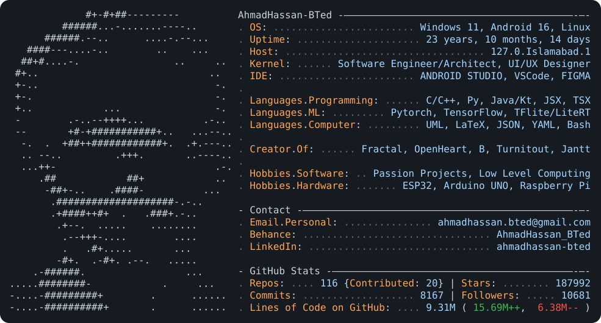

  <!-- Centerpiece: Terminal Card -->
  <picture>
    <source media="(prefers-color-scheme: dark)" srcset="dark_mode.svg">
    <source media="(prefers-color-scheme: light)" srcset="light_mode.svg">
    
  </picture>

  <!-- Top Tier: The 3 Crowning Violet Titles -->
  

    
    
    
  

  <!-- Bottom Tier: Foundation Proof & Velocity -->
  

    
    
    
    
  

